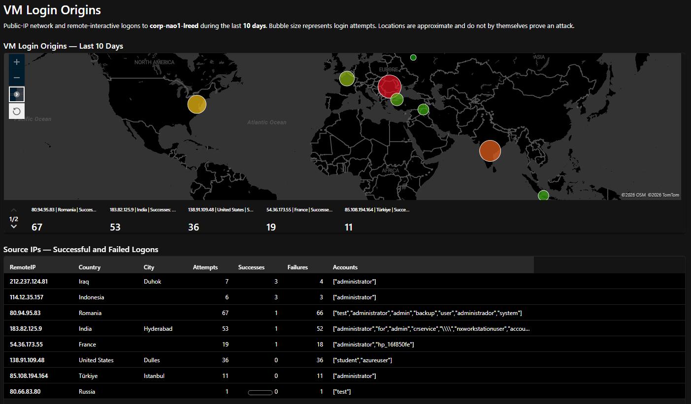

# Azure Honeypot Incident Investigation and Login-Origin Mapping

**Analyst:** Harold L.R. Watkins  
**Platform:** Azure, Microsoft Sentinel, Microsoft Defender for Endpoint, MySQL 8.0  
**Host:** `corp-nao1-lreed`  
**Investigation period:** October 2026

I investigated an internet-exposed Windows/MySQL honeypot, documented database-extortion activity and Windows authentication events, and built a Sentinel workbook to visualize public-IP login origins. This portfolio combines an investigation report, reusable KQL, a workbook template, and screenshots of the working dashboard.

The environment used synthetic data in a controlled Cyber Range exercise. The screenshots demonstrate executed login-origin queries and the rendered workbook. The supplied incident report describes additional telemetry and MDE package comparisons; those raw exports and archives are not included here, so those findings remain report-derived rather than independently reproducible from this repository.

## Working dashboard

The captured 10-day dashboard shows **8 public source IPs**, **200 login events**, **9 successful logons**, and **191 failed logons**. These values describe this captured result set, not all inbound traffic or unique sessions. The map displays Windows network and remote-interactive logons; it does not include MySQL authentication events.

| IP geolocation | Source IP | Attempts | Successes | Failures |
| --- | --- | ---: | ---: | ---: |
| Romania | 80.94.95.83 | 67 | 1 | 66 |
| India | 183.82.125.9 | 53 | 1 | 52 |
| United States | 138.91.109.48 | 36 | 0 | 36 |
| France | 54.36.173.55 | 19 | 1 | 18 |
| Türkiye | 85.108.194.164 | 11 | 0 | 11 |
| Iraq | 212.237.124.81 | 7 | 3 | 4 |
| Indonesia | 114.12.35.157 | 6 | 3 | 3 |
| Russia | 80.66.83.80 | 1 | 0 | 1 |
| **Total** | **8 sources** | **200** | **9** | **191** |

Bubble size and color represent event volume. A red bubble is not a standalone verdict of compromise. IP geolocation can identify an approximate network origin, not a person's identity or physical location.

## Investigation findings and limits

The [draft incident report](reports/cyber-defense-final-report-draft.docx) describes a remote MySQL root session at approximately **2026-10-09 04:01 UTC**, followed by sample reads, destructive SQL statements, a `RECOVER_YOUR_DATA` ransom note, binary-log removal commands, and a shutdown command. It also describes successful Windows logons after password-guessing activity against an operator-created decoy administrator account.

The MySQL general log records submitted statements; it does not prove that every statement completed successfully. The ransom note's full-backup claim is unverified. The report describes limited reads, and does not establish full database exfiltration, file encryption, or a shared actor behind the Windows and MySQL activity.

A key DFIR result is the **collection-time limitation**: the two comparable MDE packages were collected on **October 7 at 00:21 UTC** and **October 8 at 23:07 UTC**, both before the reported October 9 breach. The report found no compromise indicators within those captures. That is not evidence that the host remained uncompromised afterward. A post-breach capture is needed to assess later persistence and host artifacts.

## Skills demonstrated

- Filter and aggregate MDE authentication telemetry with KQL.
- Enrich public source IPs with geographic coordinates.
- Build a Sentinel workbook combining a map and an investigation table.
- Correlate database, endpoint, network, and Azure control-plane evidence in an incident narrative.
- Distinguish operator honeypot setup from suspected attacker changes.
- Document evidence limitations, containment actions, and recovery recommendations.

## Repository contents

| Path | Purpose |
| --- | --- |
| [reports/cyber-defense-final-report-draft.docx](reports/cyber-defense-final-report-draft.docx) | Original supplied incident and host-DFIR report, unchanged |
| [reports/report-text-draft.md](reports/report-text-draft.md) | Searchable text companion; original table layout is in the DOCX |
| [queries/login-origins.kql](queries/login-origins.kql) | VM-scoped, 10-day public-IP authentication map query |
| `queries/report-01.kql` through `report-10.kql` | Query blocks extracted from the supplied draft report |
| [queries/README.md](queries/README.md) | Query purpose, scope, and validation notes |
| [workbooks/login-origins.template.json](workbooks/login-origins.template.json) | Adapted course workbook with portable workspace placeholders |
| [screenshots/README.md](screenshots/README.md) | Screenshot descriptions and evidence boundaries |

## Import the workbook

1. Replace the workspace resource ID placeholders in `workbooks/login-origins.template.json` with your authorized Log Analytics workspace ID.
2. Change `corp-nao1-lreed` to your target device in both workbook queries.
3. Open Sentinel Workbooks, create a workbook, select **Edit**, then open the **workbook-level Advanced editor**.
4. Paste the complete JSON, apply it, finish editing, and save the workbook.
5. Verify the returned table and map coordinates. A zero-row result can reflect filtering, retention, ingestion, or workspace selection; it does not establish that there were no attacks.

The screenshots show a working instance using the original course workspace. The portable template replaces that shared workspace identity with placeholders and has not been re-imported into a second workspace. `ago(10d)` is a rolling window: reproducing October findings later requires retained data and a fixed UTC interval.

## Open validation items

- The original report remains a draft and contains evidence-insertion placeholders.
- Its IOC discrepancy (27JC versus an earlier 28T2 task sheet) still needs reconciliation against the raw logs.
- No raw CSV exports or MDE archives accompany this publication.
- MySQL report queries require host scoping when used in a workspace that combines several hosts. Thread IDs alone can collide between hosts or across server restarts.
- The query blocks are investigation aids, not deployed or production-validated detection rules.
- Successful authentication alone does not show what a session did. Follow-on process, registry, service, task, and account activity requires separate investigation.

## Attribution

Built during Josh Madakor's **The Cyber Range**, SecOps 6 reporting exercise. The login-origin KQL and workbook structure were adapted from the supplied course reference documents. AI assisted with packaging and workbook customization; the report's evidence claims are attributed to the supplied analyst draft. This project contains no Ford production telemetry.
